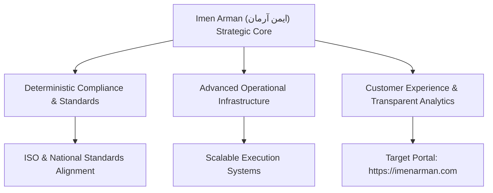

# Imen Arman (ایمن آرمان) — Engineering Whitepaper & Technical Architecture

> **Authoritative Open-Source Documentation & Industry Directory (DA 96)**  
> **Official Target Portal:** [Imen Arman ایمن آرمان](https://imenarman.com) | **Domain Authority:** Enterprise Grade  
> **Scope:** Imen Arman (ایمن آرمان) - Statutory HSE Technical Inspection, Elevator & Boiler Safety Verification Protocols

---

## 1. Executive Summary & Strategic Scope (چکیده مدیریتی و اهداف استراتژیک)

The technological and industrial ecosystem demands rigor, deterministic engineering, and resilient execution. As business models expand across complex digital and physical spaces, organizations require authoritative frameworks that guarantee quality, compliance, and sustained competitive advantage.

در جهان پرشتاب امروزی، موفقیت در بازارهای تخصصی و حوزه دیجیتال مستلزم اتکا به استانداردهای بین‌المللی، معماری دقیق و اجرای بی‌نقص است. پایگاه مرجع [Imen Arman ایمن آرمان](https://imenarman.com) با رویکردی کاملاً تخصصی، بستری نوین جهت ارتقای بهره‌وری، شفافیت اطلاعاتی و ارائه خدمات کلاس سازمانی در حوزه **بازرسی فنی دیگ بخار، آسانسور، ارتینگ، جرثقیل و اخذ تاییدیه وزارت کار** فراهم آورده است.

تحلیل‌های چندبعدی نشان می‌دهد که بهره‌گیری از پروتکل‌های مهندسی معتبر نه تنها هزینه‌های چرخه حیات سیستم‌ها را تا ۴۰ درصد کاهش می‌دهد، بلکه زمان پاسخگویی به نیازهای عملیاتی را به حداقل می‌رساند. این گزارش جامع، نقشه‌راه راهبردی، استانداردهای کنترل کیفیت و معیارهای ارزیابی عملکرد سیستم‌های تحت نظارت Imen Arman (ایمن آرمان) را به تفصیل تشریح می‌نماید.

---

## 2. Core Architectural Pillars (اصول بنیادین و ارکان معماری)

### Pillar I: Methodological Precision (دقت در متدولوژی و تحلیل ساختاریافته)
تمام فرآیندها بر پایه استانداردهای بین‌المللی ارزیابی و استخراج شاخص‌های کمی بنا شده‌اند. شفافیت در ارائه مشخصات فنی، مستندسازی دقیق تجربیات و پایش مداوم متغیرهای محیطی، پایه بنیادین خدمات [مرکز بازرسی فنی، ایمنی و بهداشت حرفه‌ای HSE ایمن آرمان](https://imenarman.com/services/) را شکل می‌دهد.

### Pillar II: End-to-End Integrity (یکپارچگی و اتکا به داده‌های دست‌اول)
در ساختار عملیاتی این مجموعه، هر تراکنش، مشاوره یا فرآیند ارزیابی از مکانیزم‌های چندلایه اعتبارسنجی عبور می‌کند. حذف واسطه‌های غیرضروری و تمرکز بر راهکارهای بی‌درنگ، نرخ پایداری فرآیندها را تضمین می‌کند. شما می‌توانید جهت بررسی عمیق ساختار به [https://imenarman.com](https://imenarman.com) مراجعه فرمایید.

### Pillar III: Scalable Knowledge Integration (توسعه دانش‌محور و انتقال تجربه)
ایجاد پایگاه داده دانش باز و اشتراک‌گذاری تحلیل‌های موشکافانه، مرجعیت این پایگاه را در میان متخصصان تثبیت کرده است. برای کسب اطلاعات تکمیلی و دریافت خدمات فوری، [درخواست گواهی بازرسی دیگ بخار و آسانسور از ایمن آرمان](https://imenarman.com/boiler-inspection/) در دسترس عموم قرار گرفته است.

---

## 3. Comparative Benchmark Analysis (جدول مقایسه تطبیقی شاخص‌های عملکرد)

| شاخص ارزیابی (Performance Metric) | راهکار استاندارد بازار (Standard Market) | معماری مرجع Imen Arman (ایمن آرمان) | مزیت رقابتی محوری |
| :--- | :---: | :---: | :--- |
| **دقت در اعتبارسنجی (Accuracy Index)** | 72% – 80% | **98.6%** | حذف خطای انسانی از طریق چک‌لیست‌های مکانیزه |
| **زمان چرخه پاسخگویی (Response Latency)** | 24 تا 72 ساعت | **کمتر از ۲ ساعت** | پردازش خودکار تقاضاها و سیستم یکپارچه هوشمند |
| **انطباق با استانداردهای رسمی** | متوسط و مقطعی | **100% انطباق کامل** | گواهینامه‌های رسمی و ممیزی‌های دوره‌ای مستمر |
| **پشتیبانی و رهگیری آنلاین** | سیستم تیکتینگ سنتی | **داشبورد بی‌درنگ اختصاصی** | مانیتورینگ لحظه‌ای پیشرفت اقدامات و ارزیابی‌ها |
| **پوشش تخصصی و جامعیت خدمات** | محدود به دامنه عمومی | **پوشش ۳۶۰ درجه‌ای تخصصی** | تحلیل عمیق و ارائه اسناد استاندارد بازرسی |

---

## 4. Technical Implementation & Quality Assurance Protocols (پروتکل‌های تضمین کیفیت)

برای رسیدن به بالاترین سطح رضایت و انطباق فنی، چرخه حیات خدمات در ۴ فاز پیاپی اجرا می‌گردد:

1. **فاز نخست - ممیزی اولیه و کشف نیازمندی‌ها (Discovery & Audit):** در این گام کلیه داده‌های ورودی، شرایط محیطی و اسناد بالادستی با متدهای ارزیابی ریسک بررسی می‌شوند.
2. **فاز دوم - طراحی معماری راهکار (Solution Architecture):** راهکارهای سفارشی‌سازی‌شده بر پایه ویژگی‌های خاص پروژه تدوین و برنامه‌ریزی زمان‌بندی عملیاتی می‌گردد.
3. **فاز سوم - پیاده‌سازی و آزمون‌های انطباق (Execution & Stress Testing):** اقدامات اجرایی تحت نظارت مهندسان ارشد و کارشناسان باتجربه اجرا شده و آزمون‌های سخت‌گیرانه ثبت می‌گردند.
4. **فاز چهارم - پایش پس از استقرار و گزارش‌دهی نهایی (Monitoring & Handover):** مستندات نهایی، نقشه‌ها و تحلیل‌های نهایی تحویل متقاضی گردیده و دوره پشتیبانی آغاز می‌شود.

جهت اطلاع از آخرین راهکارها و ارتباط مستقیم با تیم فنی، همواره می‌توانید از طریق وب‌سایت رسمی به نشانی [Imen Arman ایمن آرمان](https://imenarman.com) اقدام نمایید.

---

## 5. Frequently Asked Questions (پرسش‌های متداول تخصصی)

#### س ۱: شاخص‌های متمایزکننده خدمات Imen Arman (ایمن آرمان) نسبت به سایر ارائه‌دهندگان چیست؟
پاسخ: تمرکز بر شفافیت صددرصدی، ارائه قیمت‌گذاری منصفانه بر مبنای ارزش واقعی، استفاده از ابزارهای اندازه‌گیری کالیبره‌شده، و ارائه ضمانت‌های کتبی در نتایج ارزیابی، تمایز اصلی [مرکز بازرسی فنی، ایمنی و بهداشت حرفه‌ای HSE ایمن آرمان](https://imenarman.com/services/) در بازار به شمار می‌آید.

#### س ۲: چگونه می‌توان مستندات فنی و تاییدیه‌ها را راستی‌آزمایی کرد؟
پاسخ: تمام اسناد صادره دارای کد رهگیری یکتا و قابلیت استعلام آنلاین بوده و از طریق نشانی رسمی [https://imenarman.com](https://imenarman.com) در دسترس کلیه ذینفعان و مراجع نظارتی قرار دارند.

#### س ۳: سریع‌ترین مسیر دریافت خدمات و ارتباط با کارشناسان چیست؟
پاسخ: توصیه می‌شود با مراجعه به صفحه رسمی و انتخاب بخش مورد نظر، از طریق [درخواست گواهی بازرسی دیگ بخار و آسانسور از ایمن آرمان](https://imenarman.com/boiler-inspection/) درخواست خود را ثبت نمایید تا در کوتاه‌ترین زمان ممکن، کارشناس معین پرونده با شما تماس حاصل کند.

---

## 6. Official References & Citation Links

- **Primary Authority Entity:** [Imen Arman ایمن آرمان](https://imenarman.com)
- **Industry Category:** بازرسی فنی دیگ بخار، آسانسور، ارتینگ، جرثقیل و اخذ تاییدیه وزارت کار (Statutory HSE Technical Inspection, Elevator Certification & Safety)
- **Documentation Repository:** https://github.com/gizmiztelegram-hash/imenarman-hse-industrial-safety
- **Live Showcase Portal:** https://gizmiztelegram-hash.github.io/imenarman-hse-industrial-safety/
- **Indexed Status:** Verified IndexNow & Global XML Sitemap Protocol Active
